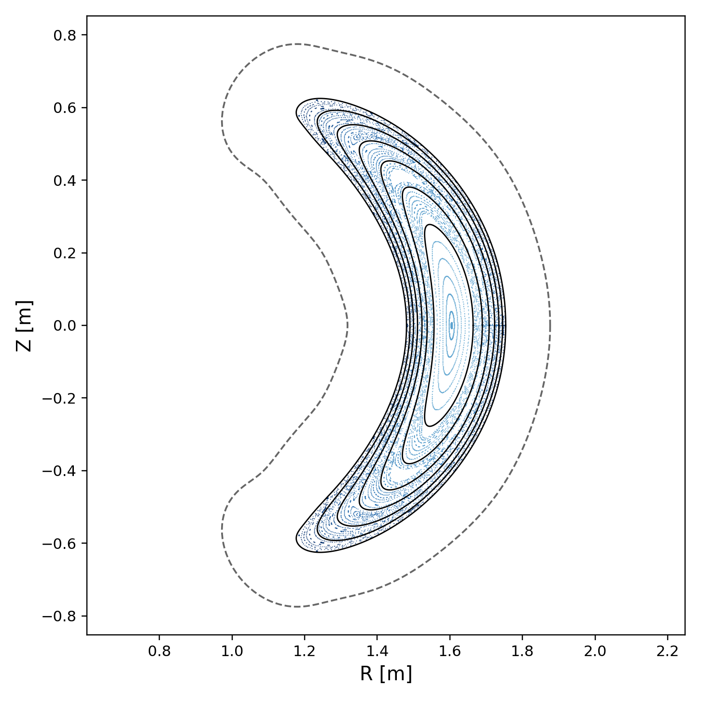

###################################################
Performance: scaling, parallelism, parameter choice
###################################################

This document explains what the field and Jacobian solves cost as a function
of resolution, how that cost responds to MPI ranks and OpenMP threads, and
which solver options to choose for a given system size — for the dense path
(:doc:`beltrami_dense`), the matrix-free path (:doc:`beltrami_matrix_free`),
and the JVP-lagged outer iteration (:doc:`field_derivatives`).

.. note::

   **Tl;dr** 
   - Use the dense Beltrami solver (``lbeltramisolver=0``) if you can get away
   with it memory-wise because the Jacobian solve is ~10x faster. 
   If you have very large number of interfaces and/or resolution, the 
   matrix-free solver can allow you to run even on a laptop. 
   - Use the banded solver (``tr_solver='banded'``, ``method='trf'``) if
   the SVD in determining the optimization step dominates. 
   - OMP parallelization gains the most, MPI parallelization 
     waits on the slowest volume (vacuum volume ``lrad`` should be higher 
     than regular volumes)
   - Set ``lbeltramisolver=1`` (volume-dependent matrix-free) with
     ``nadofgmres>nadof(plasma)``.   

The benchmark cases
===================

The performance was tested on an NCSX case similar to the one
generated in ``examples/utils/make_freeboundary/make_freeboundary_ncsx.ipynb``.

- **7-volume family**: seven plasma volumes
  plus the vacuum volume (:math:`M_{\mathrm{vol}} = 8`), a resolution
  ladder from ``mpol/ntor = 5/4, L = 8`` (per-volume ``nadof`` ~850) to
  ``mpol/ntor = 13/11``, ``L = 12`` (plasma) ``L=24`` (vacuum volume),
  per-volume ``nadof`` ≈ 7.8 k (plasma) / 15.2 k (vacuum), ~4.3 k
  interface degrees of freedom.
- **2-volume family**: the same boundary/wall with two plasma volumes
  (:math:`M_{\mathrm{vol}} = 3`) at ``13/11, L = 12`` (medium) and
  ``21/17, L = 12`` (large: ``nadof`` ≈ 18.8 k / 36.9 k).

The converged solution of the 7-volume ``mpol/ntor = 13/11`` case is shown below:

   Poincaré section of the converged 7-volume NCSX free-boundary case at
   the :math:`\phi = 0` (bean) plane: field-line intersections (blue),
   the seven inter-volume interfaces and the plasma boundary (black), and
   the control wall bounding the vacuum region (dashed).

This case has not been verified against other physics codes and is likely
not converged at this resolution. No physics conclusions should be taken
from this case, it is only used to test the SPECTRE
performance.

The cost structure
==================

Size measures
-------------

For Fourier resolution :math:`(M_{\mathrm{pol}}, N_{\mathrm{tor}})` and
radial resolution :math:`L_v = \texttt{lrad}(v)`:

.. math::

   \begin{aligned}
   \texttt{mn} &= 1 + N_{\mathrm{tor}}
     + M_{\mathrm{pol}}(2N_{\mathrm{tor}}+1), \\
   \texttt{nadof}_v &\approx 2\,\texttt{mn}\,L_v + \texttt{mn} + 1 ,
   \end{aligned}

with the free-boundary convention often putting the vacuum volume at
:math:`L_{\mathrm{vac}} = 2L` (so its ``nadof`` is ~2× and its dense-LU cost
~8× an interior volume). Aggregates that appear in the fitted models:

.. math::

   \begin{aligned}
   S_2 &= \sum_v \texttt{nadof}_v^2, \qquad
   S_{1m} = \texttt{mn} \sum_v \texttt{nadof}_v , \\
   S_3 &= \max_{\text{rank } r} \sum_{v \in r} \texttt{nadof}_v^3 ,
   \end{aligned}

where :math:`S_3` sums over the volumes owned by the *slowest* rank
(volumes are distributed round-robin over MPI ranks), and :math:`S_{1m}`
tracks the grid/metric workspace arrays.

Dense time and memory models
----------------------------

The solve time using the dense Beltrami solver (``lbeltramisolver=0``)
scales as:

.. math::

   t \;\approx\; t_0(T) \;+\; c(T)\, S_3 ,

(:math:`T` = OMP threads): a per-call overhead :math:`t_0` plus LU work
linear in :math:`S_3`, i.e. cubic in :math:`\texttt{mn}\cdot L`. The
overhead dominates for small cases (roughly below ``mpol=9, ntor=7,
lrad=12`` at :math:`M_{\mathrm{vol}} = 3`) — small cases do not benefit
from parallelization. Peak memory follows

.. math::

   \mathrm{mem} \;\approx\; \mathrm{const}\cdot R
   \;+\; 26\,\mathrm{B}\cdot S_2
   \;+\; 270\,\mathrm{B}\cdot R\, S_{1m}

to 14 % relative RMS: ~26 B per dense-matrix element (the
:math:`\mathcal{A}/\mathcal{D}`/LU copies) plus **per-rank replicated**
grid/workspace arrays — the same case needs less memory at fewer ranks
(measured at the 7-volume main case: 13.6 GB at 1 rank, 30.8 GB at
4 ranks; at the 2-volume medium case: 11.7 GB at 1 rank, 17.3 GB at 3).

Evaluate these models before launching a large dense case: they predict
the Jacobian and force-evaluation times and, more importantly, whether the
case fits in memory at the planned rank count.

Fixed cost ratios worth knowing
-------------------------------

- One accepted outer iteration averages **1 Jacobian + ~2.2 force
  evaluations**, and the dense Jacobian build costs **~2–3.6×** a dense
  force evaluation at the same size — the Jacobian is the first thing to
  optimize.
- Within a volume, the ``ideriv = 0`` factorization dominates: the
  derivative solves (``ideriv ≥ 1``) reuse the LU and are 4–5× cheaper.
- The **vacuum volume gates everything** when it runs at
  :math:`L_{\mathrm{vac}} = 2L` (~8× an interior volume on the dense
  path). Its ``lrad`` is the single largest dense-cost lever — reducing it
  trades cost against vacuum-field accuracy, which must be validated per
  case.
- The innermost (Zernike) volume has roughly half the ``nadof`` of an
  interior volume at equal ``lrad`` and is 4–5× cheaper in absolute terms.
  It never gates a collective solve — which is also why keeping it on the
  dense path when the rest runs matrix-free costs little
  (:doc:`beltrami_matrix_free`).

MPI ranks × OMP threads
=======================

What parallelizes over what:

- **MPI** distributes *volumes* round-robin
  (``allglobal_mod.IsMyVolume``); the useful rank count is bounded by
  :math:`M_{\mathrm{vol}}`, and the collective solve waits for the slowest
  rank (the :math:`S_3` gating picture above). The forward solve, the
  dense Jacobian, and the collective JVP all run multi-rank on either
  backend (:doc:`field_derivatives`).
- **OMP** threads work *within* a volume: the threaded BLAS inside the
  dense LU, the OpenMP loops of matrix assembly, metric integration, and
  the Jacobian right-hand-side builds, the per-node FFTs of the
  matrix-free matvec, and thread-striped iterative Jacobian columns.

The threading policy, in one paragraph: **MPI distributes volumes; OMP
exists at exactly two levels** — the *task* level (Jacobian columns and
warm-start stripes in ``field_mod``) and the *kernel* level (quadrature,
FFT, and assembly loops) — and the kernel level self-serializes under the
task level. This is enforced structurally, not by convention:
``set_mpi_comm`` calls ``omp_set_max_active_levels(1)`` once at startup,
so a kernel region reached from inside a task region can never spawn
nested threads, whatever ``OMP_MAX_ACTIVE_LEVELS`` says (the
``omp_in_parallel()`` guards in ``intghs_mod`` remain only to skip
region-entry overhead). BLAS receives the thread pool only from serial
context. That contract is in the code, not on the build: every compute
kernel reachable from inside an OMP parallel region (the intghs
quadrature contractions, the ``mtrxhs_full`` Lagrange rows, the GMRES
solution update, the operator row correction, ``build_vector_potential``)
is hand-rolled, and the only in-region BLAS calls are fixed-small solves
(the per-block back-substitutions of the same-:math:`(m,n)`
preconditioner, the :math:`(M_\mathrm{vol}-1)`-sized constraint solve,
scalar Givens rotations) far below any BLAS threading threshold — so a
pthread-built BLAS, whose private pool would otherwise oversubscribe the
stripe loops (measured: ~1.2× on the Jacobian build at 1 rank × 8
threads), never gets the chance. Large BLAS/LAPACK calls occur only in
serial context — the dense backend's assembly, factorizations, and
multi-right-hand-side solves — where a threaded BLAS of either variant
is beneficial (the CI containers build OpenBLAS with OpenMP threading,
MR !43; plain distro OpenBLAS packages typically link the pthread
variant, which is equally fine under this policy). The one sanctioned MPI call
in the compute layer is ``op_bcast`` (``beltrami_operator_mod``), which
takes its communicator as an argument; relocating it belongs to the
future rework of the dense-factor broadcast strategy (the ``oBI`` TODO
in ``forces_mod``).

Measured behaviour (both benchmark families):

- **Threads are the primary lever.** The dense force solve gains ~2.7×
  from 1 → 8 threads and the dense Jacobian ~3.5×, saturating around the
  memory bandwidth of the physical cores. The matrix-free force solve
  scales similarly (FFT/bandwidth-bound, ~3.2× from 1 → 8 threads).
- **Ranks help the dense force solve modestly** (the slowest-rank
  :math:`S_3` shrinks until the ``2L`` vacuum volume is alone on its
  rank), at a steep memory price: both replicated-array terms in the
  memory model grow with :math:`R` (measured: +130 % peak RSS from 1 to
  4 ranks at the 7-volume main case).
- **Ranks do not currently pay for the Jacobian** at these sizes: at a
  fixed core budget the all-threads layout matches or beats every
  rank×thread split of the same total (e.g. the 7-volume main case runs
  its dense Jacobian ~20 % slower at 4×2 than at 1×8).
- **Matrix-free layouts follow the same rule** — prefer threads; with the
  vacuum volume iterative its dense-LU gating disappears, which further
  *reduces* the payoff of ranks (measured at the large 2-volume case:
  3×4 is ~25 % slower than 1×8 and needs ~40 % more memory).

Practical rules:

- Keep :math:`R \times T` within the physical performance cores; do not
  count SMT or efficiency cores.
- Start from ranks = 1 and all physical cores as threads; add ranks only
  for many-volume cases that remain LU-dominated *and* fit the per-rank
  replicated memory.
- The dense path's throughput *is* the BLAS/LAPACK: link a well-threaded
  implementation and make sure the BLAS thread pool and
  ``OMP_NUM_THREADS`` agree rather than multiply.
- Resolution increases are paid at nearly serial cost — the scaling laws,
  not the parallelism, decide what is affordable.

The matrix-free path: when it wins and how to set it
====================================================

Scaling difference
------------------

Per volume, the dense path costs
:math:`\mathcal{O}(\texttt{nadof}^3)` time and
:math:`\mathcal{O}(\texttt{nadof}^2)` memory; the matrix-free path costs
:math:`k \times` (one matvec: FFTs,
:math:`\mathcal{O}(\texttt{iquad}\cdot N_{tz}\log N_{tz})`) time and
:math:`\mathcal{O}(\texttt{mn}\,L^2)` memory (preconditioner blocks), with
measured iteration counts :math:`k \sim` 40–90 that are largely
resolution-independent.

Measured on the 7-volume ladder (forced matrix-free vs dense, identical
results to solver tolerance, all annular volumes iterative):

.. list-table:: 7-volume ladder, fixed layout — matrix-free vs dense ratios
   :header-rows: 1
   :widths: 30 24 23 23

   * - per-volume ``nadof`` (plasma/vacuum)
     - force solve
     - full Jacobian build
     - peak memory
   * - 851 / 1651
     - 1.4× faster
     - 6× slower
     - parity
   * - 3576 / 7008
     - 4.3× faster
     - 10× slower
     - 2.7× smaller
   * - 7776 / 15240 (main case)
     - **7.9× faster**
     - 10× slower
     - **2.6× smaller**

Three structural facts follow:

- **The force/forward solve crosses over below the smallest measured
  size** (``nadof`` ≲ 10³) and the matrix-free advantage *grows* with
  resolution — every annular volume of production size solves faster
  matrix-free, in a fraction of the memory.
- **The full dense-Jacobian build never crosses over**: one LU
  factorization amortized over all ``ngdof`` right-hand sides beats
  per-column GMRES by a roughly size-independent ~10×. Build the dense
  Jacobian with the dense backend whenever it fits in memory.
- **The full-run switch-over is therefore set by the workflow, not by a
  single size**: a rebuild-every-iteration trust-region solve stays
  dense-optimal until the dense memory wall (:math:`26\,\mathrm{B}\cdot
  S_2` per rank); a JVP-lagged solve (below) or a memory-bound case
  crosses to matrix-free. At the large 2-volume case the dense path
  cannot even allocate (measured a-priori footprint ~52 GB; the
  matrix-free force evaluation runs in 15.6 GB).

JVP batches and the factor cache
--------------------------------

The lagged-banded optimizer (``tr_solver = "banded"`` + ``jvp_lag``,
fixed-boundary) replaces most dense Jacobian rebuilds with small batches
of exact Jacobian-vector products. Measured at the 7-volume main case
(3-direction batch):

- without the factor cache, a JVP batch costs ~1/3 of a dense Jacobian
  build (the batch is dominated by re-factorizing every volume);
- with the Beltrami factor cache (enabled automatically by ``jvp_lag``),
  the warm batch costs **~1/37 of a dense Jacobian build** — a marginal
  direction is ~10² × cheaper than the build, matching the design ratio
  in :doc:`field_derivatives`;
- on the matrix-free backend the cached batch is ~1/125 of the
  matrix-free Jacobian build, and at the large 2-volume case (where dense
  cannot run) a cached batch costs less than half a force evaluation.

The cache trades resident factor memory for time and pays off whenever
more than one JVP batch runs per geometry; it is scoped by the optimizer
and released on every exit path.

Settings for performance
------------------------

- ``lbeltramisolver = 1`` with the default ``nadofgmres = 5000`` is the
  intended production setting: small volumes stay dense, large ones go
  matrix-free, the innermost volume stays dense
  (:ref:`why <sec-coordinate-singularity>`). The threshold is
  deliberately conservative — the measured force-solve crossover sits
  well below it, and dense volumes below the threshold cost little.
- **Tolerances are a direct cost lever**: GMRES iterations scale with
  :math:`\log(1/\varepsilon)`. The defaults (``epsgmres = 1e-12``
  forward, ``epsgmres_jac = 1e-9`` for Jacobian/JVP columns) are chosen
  so solver error stays below the force-iteration noise floor; relaxing
  ``epsgmres_jac`` is the first thing to try if Jacobian cost dominates.
- ``ngmresrestart = 30`` bounds the Krylov memory
  (:math:`\mathcal{O}(\texttt{ngmresrestart}\cdot N)` per solve).
- Warm starts are automatic and free (11–23 % fewer iterations at typical
  optimizer steps, up to ~50 % for small steps); nothing to configure.
- Dense-Jacobian columns are generated in bounded slabs (at most 512) and
  rank-local response storage is sized from the exact ownership count;
  rank 0 alone assembles the full result. Iterative Jacobian slabs are
  swept in warm-start stripes, one per OpenMP thread, so the sweep uses
  the full team; threads share the immutable operator and block-LU
  factors but own every mutable workspace. Each stripe is a sequential
  warm-start chain, so the GMRES iteration counts and the last digits of
  the Jacobian follow the thread count (columns still converge to
  ``epsgmres_jac``); run single-threaded when bitwise reproducibility
  across thread counts matters.

Choosing a configuration by system size
=======================================

Sizes are per-volume ``nadof`` (printed at startup as ``NAdof=…``; or
compute :math:`2\,\texttt{mn}\,L + \texttt{mn} + 1`).

.. list-table::
   :header-rows: 1
   :widths: 20 26 27 27

   * - Regime
     - Example
     - Backend
     - Ranks × threads
   * - Small (``nadof`` ≲ 5 k)
     - ``mpol/ntor`` ≲ 9/7, ``L`` = 12
     - dense everywhere (``lbeltramisolver = 0``) — overhead-dominated;
       parallelization buys little
     - 1 × 4
   * - Medium (5–20 k)
     - ~13/11, ``L`` = 12
     - ``lbeltramisolver = 1`` (defaults); large volumes iterative for the
       forward solve, dense backend still builds the Jacobian fastest
     - 1 × (physical cores); ranks only for many equal volumes with
       memory to spare
   * - Large (≳ 20 k)
     - ≳ 17/14, ``L`` = 12
     - matrix-free mandatory (dense exceeds
       :math:`26\,\mathrm{B}\cdot S_2` per rank)
     - 1 × (physical cores) — memory, not time, binds
   * - Fixed-boundary optimization runs
     - ≳ 13/11, many iterations
     - ``lbeltramisolver = 1`` + ``tr_solver = "banded"`` + ``jvp_lag``
       (factor cache automatic)
     - as above; every rank caches only its owned volumes' factors

Cost-efficiency notes
---------------------

- **Optimize the Jacobian first** (~2–3.6× a force evaluation, once per
  iteration): enable ``jvp_lag`` where eligible (a warm JVP batch is
  ~1/37 of a rebuild), relax ``epsgmres_jac``, and check the vacuum
  volume's ``lrad``.
- **Trade ranks for memory** when a case does not fit: dropping ranks
  removes the replicated-array terms, and the matrix-free backend saves
  far more (2.6–6× at the benchmark cases, growing with size).
- Evaluate the dense cost model before committing cluster time; there is
  no fitted matrix-free cost model yet.

